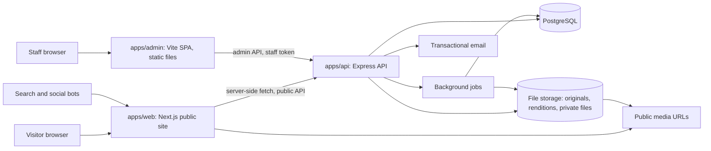

# Architecture

How the parts fit together. Decisions and their reasons are in [adr/](adr/README.md); this document describes the resulting system and is updated whenever an ADR changes it.

## System overview



| App | Responsibility | Talks to |
|---|---|---|
| `apps/web` | Public pages rendered on the server, SEO metadata, sitemap, robots, redirects (301), public forms (inquiry, viewing request, consultation), locale routing | Public API only. No database access, no business rules |
| `apps/admin` | Internal back office: catalog, taxonomies, media, team, content, inquiries, users and roles | Admin API only |
| `apps/api` | All business rules, persistence, permissions, audit, history, file handling, jobs, email, revalidation calls to `web` | Postgres, storage, email provider |
| `packages/shared` | zod schemas, types and constants used by more than one app (locales, enums, permission keys, form schemas) | Nothing at runtime |

The API is the single owner of data. `web` and `admin` never share code beyond `packages/shared`, which ships TypeScript source only and is compiled by each consumer (rules in [packages/shared/README.md](../packages/shared/README.md)).

## API surface

| Prefix | Who | Auth | Serializers |
|---|---|---|---|
| `/v1/public/*` | `apps/web` (server side) and public form posts | None; rate limited, bot protection on writes | Public: never contain exact address for approximate properties, owners, internal files, finance, internal notes |
| `/v1/admin/*` | `apps/admin` | Staff token + permission check per action, resource and field | Admin: fields filtered by the caller's permissions |
| `/health` | Operations | None | |

Response conventions (from Newscore_Backend): lists return `{ data, total, offset, limit }`; errors return `{ error: { code, message, details? } }` with stable codes.

## Key flows

### Public page render

1. A request reaches `web`. The `proxy` (Next.js 16 name for middleware) resolves locale (Bulgarian unprefixed, English under `/en/`) and checks the redirect table (cached) for legacy or changed slugs; a hit returns **301** to the current URL.
2. The page (server component) fetches public data from the API and renders HTML with metadata, Open Graph tags, hreflang and JSON-LD.
3. Responses are cached; when an admin publishes, edits or unpublishes something, the API calls a protected revalidation endpoint in `web` for the affected paths.
4. Only interactive parts (gallery, filters, forms, share) are client components.

### Search

Filters are part of the URL (shareable, back/forward work). `web` passes them to `/v1/public/properties`; the API translates them to SQL on indexed columns and JSONB attributes (filter definitions come from the admin-managed attribute configuration). Sorting defaults to newest published first.

### Inquiry and viewing request

1. A public form posts to `web`, which forwards to `/v1/public/inquiries` with the property ID, source and UTM data.
2. The API validates (shared zod schema), checks bot protection and rate limits, stores the inquiry linked to the property and its responsible agent, writes the audit entry and queues an email to the agent.
3. The visitor sees a confirmation that the request was received, never a confirmed booking.

### Admin edit

1. `admin` loads data through TanStack Query hooks (query-key factory per resource) and submits forms validated with the same zod schemas the API uses.
2. The API checks permissions in the service layer, applies the change in a transaction, writes history (price, status, slug, responsible agent) and the audit log, then triggers revalidation of the affected public pages.

### Media upload (EPIC-05, details by ADR)

Upload goes to storage; the original is never modified; a background job creates renditions (web sizes, thumbnails, social JPEG 1200x630, optional watermark). Public renditions get public URLs; private files are served only through short-lived signed links after a permission check.

## Cross-cutting rules

From the specification; every module follows them (details in [requirements analysis](requirements/01-luxury-investment-spec.analysis.md#cross-cutting-rules-that-shape-the-architecture)):

1. Authorization on the server, including field level.
2. History is appended, never overwritten.
3. Separate public and internal projections of the same data.
4. Admin-configurable lists and attributes, no code changes.
5. Archive or merge instead of deleting referenced data.
6. Everything translatable; more languages without remodelling.
7. Honest numbers: no invented data, manual data labelled, no double counting.

## Code layout per app

### `apps/api`

```
src/
├── config/                 env schema (zod) and typed config
├── errors/                 error hierarchy and code map
├── infrastructure/
│   ├── db/                 Drizzle client, schema index, migrations, seeds
│   ├── server/             app factory, middleware (validation, auth, errors, rate limit), routers
│   ├── storage/            storage interface + adapters
│   └── email/              email interface + adapters
├── modules/<context>/      e.g. properties, taxonomies, team, inquiries, users
│   ├── domain/             entities, value objects, domain errors
│   ├── repo/               Drizzle queries + mappers (DB row <-> domain)
│   ├── app/                read and write services (permissions checked here)
│   ├── handlers/           public and admin Express handlers
│   └── serializers/        public and admin output shapes
└── utils/
```

### `apps/web`

```
src/
├── app/[locale]/           routes (App Router); route segments match the current site where URLs must be kept
├── components/             shared UI by domain (layout, property, search, team, forms, ui)
├── lib/
│   ├── api/                typed server-side client for /v1/public
│   ├── seo/                metadata, JSON-LD, hreflang helpers
│   └── config/             env schema (zod)
├── i18n/                   next-intl routing and request config
├── messages/               bg.json, en.json
├── styles/                 Tailwind entry and theme tokens
└── proxy.ts                locale routing + legacy and slug redirects (301)
```

### `apps/admin`

Same structure as Fantasy_Web_Admin (see `.cursor/skills/luxury-investment-workflow/reference-stack.md`): `api/`, `components/`, `config/`, `constants/`, `contexts/`, `hooks/`, `locales/`, `pages/<Feature>/`, `types/`, `utils/`.

## Testing strategy

| Level | Tool | What |
|---|---|---|
| Unit | Vitest | Domain logic, mappers, utils, hooks, shared schemas |
| API integration | Vitest + supertest against a real Postgres (test database) | Endpoints, permissions (including "cannot read through direct URL"), public serializers never leaking hidden fields |
| End to end | Playwright | Critical flows from `10_USER_FLOWS_AND_ACCEPTANCE.md` on desktop and mobile viewports, added per epic |
| Static checks | TypeScript, ESLint, Prettier | Every commit (Git hooks) and CI |

Every acceptance flow (FLOW-001..015) that a release covers gets at least one automated check.

## Environments and configuration

- **Local**: Docker Compose Postgres; all apps run with `npm run dev`; seed data only (see the skill's "Development data").
- **Test**: separate local database for integration tests.
- **Staging and production**: defined by the hosting ADR.
- Each app validates its environment variables with zod at startup and reads them through one config module. `.env.example` files list every variable with placeholders.

## Versions

Pinned at scaffolding time (EPIC-01) and kept current by Dependabot or an equivalent:

- Node 26 LTS (Active LTS from 2026-10-28);
- TypeScript 6 (TypeScript 7 has no JavaScript API yet, which typescript-eslint needs; switch with TypeScript 7.1);
- Next.js 16 (App Router; `proxy.ts` instead of `middleware.ts`);
- Drizzle ORM stable 0.45.x; upgrade to 1.0 once it is final (currently release candidate);
- React 19, Vite, Chakra UI v3, Tailwind CSS v4, Express 5, TanStack Query v5, next-intl, i18next, zod.
